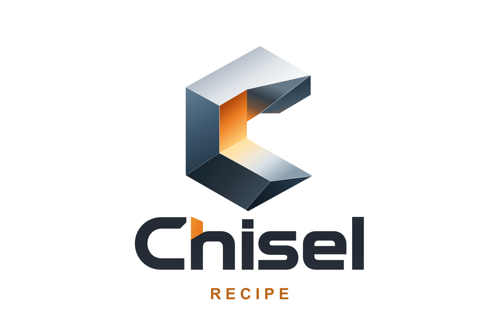

<p align="center">
  <picture>
    <source media="(prefers-color-scheme: dark)" srcset="logo/chisel-recipe-dark.svg">
    
  </picture>
</p>

# chisel-spark-recipes

Tuned LLM serving recipes for one NVIDIA DGX Spark (GB10). Each one is published with its measured single-user decode speed and its task scores against the model's own BF16 weights.

These recipes come from [Chisel](https://github.com/yuanlin2004/chisel), which automates building the inference stack for a given model on a given machine.

## Models

| Model | Best recipe | Decode, one user | Quality vs BF16 | Recipes |
|---|---|---|---|---|
| Qwen3.8-27B | [chisel-nvfp4-dflash2-replay](recipes/qwen3.8-27b/chisel-nvfp4-dflash2-replay.md) | **65.1 tok/s** (15.35 ms/token median) | 99.3–101.2% on 4 tasks | [3 recipes](recipes/qwen3.8-27b/README.md) |

Each recipe has its own page with its speed, quality, spark-arena entries and run command, and a folder under [`results/`](results/) with the raw benchmark and quality files, the versions used, and how to reproduce them. A published recipe and its results never change; a better result is a new recipe.

## Run a recipe

With [sparkrun](https://github.com/spark-arena/sparkrun):

```
sparkrun registry add https://github.com/yuanlin2004/chisel-spark-recipes
sparkrun run @chisel/<recipe> --tp 1 --hosts localhost
```

The server is OpenAI-compatible on port 8000.

## Repository layout

```
recipes/<model>/README.md            the model's recipes, with a summary table
recipes/<model>/<recipe>.md          one recipe: what it is, speed, quality, spark-arena entries, how to run it
recipes/<model>/<recipe>.yaml        sparkrun recipe (and <recipe>.docker.sh, the same without sparkrun)
recipes/<model>/mods/                files sparkrun installs into the container at start (plugins a recipe uses)
plugin/                              chisel-draftvocab, a vLLM general plugin; passes are off unless a recipe turns them on
results/<model>/<recipe>/<date>/     benchmark/, quality/, outputs/, ENVIRONMENT.md, METHOD.md
results/<model>/bf16-reference/      BF16 task scores every recipe for that model is compared against
prompts/                             the prompt sets the benchmarks use, with their sources
tools/                               the benchmark, output-check and quality-check scripts
```

## License

Apache-2.0. Model weights are under their own licences (Qwen3.8-27B, unsloth's NVFP4 checkpoint, z-lab's DFlash2 drafter and Chisel's NVFP4 drafter: all Apache-2.0).
